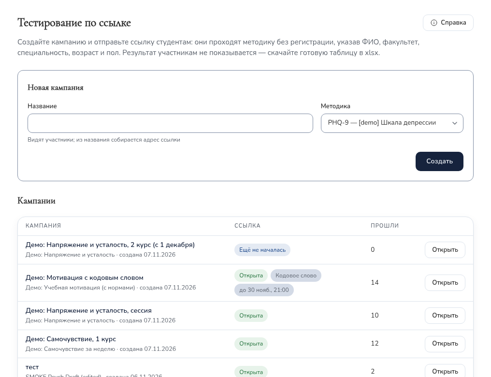
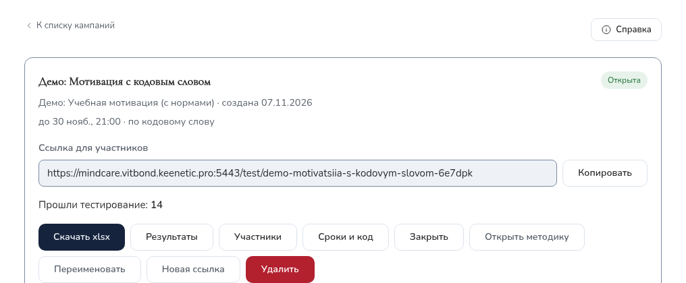
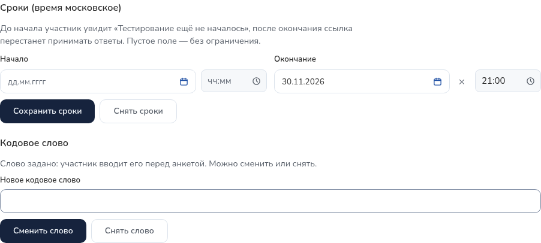
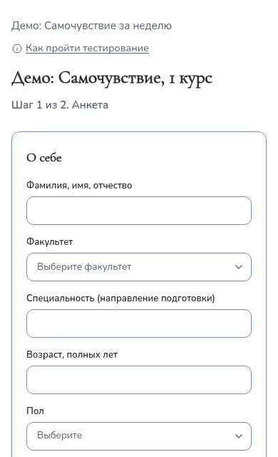
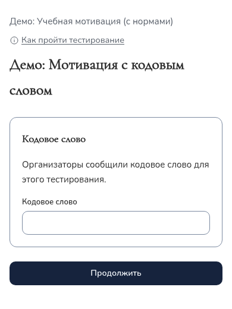
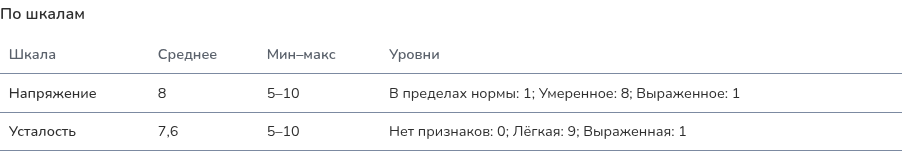
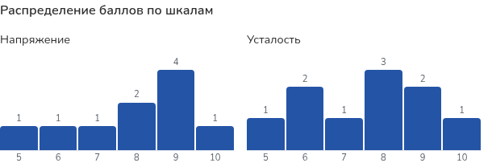

## 1. Как это устроено {#overview}

Тестирование проводится **кампаниями**. Кампания — это одно тестирование одной
группы студентов (курса, потока, факультета) по одной методике. Сайт выдаёт для
кампании **одну ссылку на всех участников**.

Студент открывает ссылку без регистрации, заполняет короткую анкету, даёт
согласие на обработку персональных данных и отвечает на вопросы методики.
Результат студенту не показывается. Сотрудник центра видит в кабинете, сколько
человек прошло, смотрит обработку и статистику и скачивает таблицу xlsx с
диаграммами.

| Этап | Кто и где |
|---|---|
| 1. Кампания | Супервизор создаёт кампанию, при необходимости задаёт сроки и кодовое слово (разделы 2–4). |
| 2. Рассылка | Супервизор или куратор отправляет ссылку студентам (раздел 5). |
| 3. Прохождение | Студенты проходят тест с телефона или компьютера (раздел 6 и [памятка участнику](participant.html)). |
| 4. Завершение | Срок заканчивается сам или супервизор закрывает кампанию (раздел 7). |
| 5. Результаты | «Результаты», «Статистика», таблица xlsx (разделы 8–10). |
| 6. Хранение | Обращение с данными, удаление ответов (раздел 11). |

Методики (тесты), по которым проводится тестирование, создаются и правятся в
разделе «Тесты» — об этом отдельное руководство «[Методики](methodologies.html)».

Адрес сайта: **https://mindcare.donnu.ru**. Все действия выполняются в личном
кабинете после входа, в кабинете **«Супервизор»**, раздел меню
**«Тестирование по ссылке»**. На каждой странице есть кнопка **«Справка»** —
она открывает это руководство.

## 2. Создание кампании {#create}

| № | Что сделать | Что вы увидите |
|---|---|---|
| 1 | В меню слева выбрать «Тестирование по ссылке». | Форма «Новая кампания» и список кампаний. |
| 2 | В поле «Название» ввести название, которое увидят студенты, например «ИТО Экономфак 2026». | — |
| 3 | В поле «Методика» выбрать методику и нажать «Создать». | Открывается страница новой кампании: статус «Открыта», «Прошли тестирование: 0», поле со ссылкой. |
| 4 | Нажать «Копировать» рядом со ссылкой. | «Ссылка скопирована» — её можно вставить в мессенджер или письмо. |

**Список кампаний.** В строке — название, методика, дата создания, состояние
ссылки, значки «Кодовое слово» и «до …» (срок окончания) и число прошедших.
Кампания открывается кнопкой «Открыть» или щелчком по названию.

| Состояние | Что значит |
|---|---|
| Открыта | Ссылка принимает ответы. |
| Ещё не началась | Задано время начала, оно не наступило (раздел 4). |
| Срок истёк | Наступило время окончания — ответы не принимаются. |
| Закрыта | Кампанию закрыли кнопкой «Закрыть». |

### Как выглядит ссылка

Ссылка собирается из названия кампании латиницей и заканчивается шестью
случайными символами, например `https://mindcare.donnu.ru/test/ito-ekonomfak-2026-k7m2xq`.
Случайная часть не даёт посторонним подобрать адрес, поэтому ссылку копируют
целиком, без изменений.

### Советы

- Делайте отдельную кампанию на каждую группу, которую потом нужно анализировать
  отдельно (поток, факультет, курс, год). Внутри кампании результаты можно
  разделить фильтрами по факультету и полу, но не по группе или курсу.
- Название видят студенты — пишите его понятно, без служебных пометок.
- Повторное тестирование той же группы (например, через год) — новая кампания:
  так результаты не смешаются.
- В поле «Методика» есть все опубликованные методики центра. Если нужной нет —
  она не опубликована, скрыта или заменена новой версией (см. «[Методики](methodologies.html#where)»).

## 3. Страница кампании {#campaign-page}

Под названием — методика, дата создания, сроки и отметка «по кодовому слову»,
если они заданы. Ниже — ссылка для участников и счётчик «Прошли тестирование».

| Кнопка | Что делает |
|---|---|
| Копировать | Копирует ссылку для участников. |
| Скачать xlsx | Таблица результатов с диаграммами (раздел 10). Доступна, когда есть хотя бы один ответ. |
| Результаты | Обработка и статистика на экране (разделы 8–9). |
| Участники | Список прошедших: ФИО, факультет, специальность, возраст, пол, время. Здесь удаляют отдельный ответ. |
| Сроки и код | Время начала и окончания, кодовое слово (раздел 4). |
| Закрыть / Открыть снова | Остановить приём ответов или возобновить его. |
| Открыть методику | Переход к методике этой кампании в разделе «Тесты». |
| Переименовать | Новое название. **Адрес ссылки не меняется** — разосланная ссылка продолжает работать. |
| Новая ссылка | Выпускает новую ссылку; старая сразу перестаёт работать, ответы сохраняются. |
| Удалить | Удаляет кампанию со всеми ответами (раздел 11). |

Вернуться к списку — «К списку кампаний» вверху страницы.

## 4. Сроки и кодовое слово {#schedule}

Кнопка **«Сроки и код»** на странице кампании открывает панель настроек.

**Сроки (время московское).**

- **Начало** — до этого времени участник увидит «Тестирование ещё не началось»
  с датой начала, анкета не откроется. Удобно разослать ссылку заранее.
- **Окончание** — с этого времени ссылка перестаёт принимать ответы, как у
  закрытой кампании. Закрывать вручную не нужно.
- Пустое поле — без ограничения. «Сохранить сроки» — применить, «Снять сроки» —
  убрать оба ограничения.
- Чтобы продлить тестирование, поменяйте время окончания или снимите сроки.
  Кнопка «Открыть снова» срок не продлевает.

**Кодовое слово** — второй барьер для посторонних: участник вводит его перед
анкетой. Без слова анкета и вопросы не открываются.

- От 4 до 64 символов. Регистр и лишние пробелы не важны: «Весна 2026» и
  «весна  2026» — одно слово.
- После сохранения слово **больше не показывается** (на сайте хранится только
  его зашифрованный отпечаток). Запишите его и сообщите участникам — устно на
  занятии или отдельным сообщением.
- «Сменить слово» — задать новое; участники, начавшие тест со старым словом,
  при отправке получат просьбу ввести новое, их ответы при этом не теряются.
  «Снять слово» — анкета снова открывается по одной ссылке.

## 5. Рассылка ссылки студентам {#send}

Ссылку отправляют в чат группы, по электронной почте, через куратора или
показывают на экране на занятии. Одна ссылка подходит всем участникам кампании.

**Образец сообщения:**

> Уважаемые студенты! Центр психологии ДонГУ приглашает вас пройти
> психологическое тестирование. Это займёт около 15 минут. Регистрация на сайте
> не нужна, можно с телефона.
>
> Ссылка: &lt;вставьте ссылку кампании&gt;
> Кодовое слово: &lt;если задано — назовите на занятии&gt;
> Пройти можно до: &lt;дата и время, если задан срок&gt;
>
> Вы укажете ФИО, факультет, специальность, возраст и пол и ответите на
> вопросы. Отвечайте искренне, долго не раздумывая. Результаты обрабатываются
> специалистами центра и конфиденциальны.

К сообщению можно приложить [памятку участнику](participant.html) — на странице
теста у студента тоже есть ссылка «Как пройти тестирование».

**Перед рассылкой:**

- Откройте ссылку сами (лучше с телефона) и убедитесь, что видите название
  кампании и анкету (или поле кодового слова). Проходить тест не нужно; если
  прошли — удалите свой ответ (раздел 11).
- Не публикуйте ссылку на открытых страницах: пройти тест может любой, у кого
  она есть. Для дополнительной защиты задайте кодовое слово.
- Если ссылка попала не туда — «Новая ссылка»: старая сразу перестанет работать,
  полученные ответы сохранятся. Новую ссылку нужно разослать заново.

## 6. Что делает участник {#participant}

<figure class="phone">

<figcaption>Анкета на телефоне. Вверху — ссылка «Как пройти тестирование» и срок, до которого можно пройти тест.</figcaption>
</figure>

1. Открывает ссылку. Если задано кодовое слово — вводит его и нажимает
   «Продолжить».
2. Заполняет ФИО, факультет, специальность, возраст (14–100) и пол.
3. Читает текст согласия на обработку персональных данных и ставит отметку. Без
   согласия перейти к вопросам нельзя.
4. Нажимает «Перейти к вопросам», читает инструкцию и отвечает на все вопросы.
   Сверху — «Отвечено N из M».
5. Нажимает «Отправить ответы». Если что-то пропущено, сайт подсветит пропуски.
6. Видит «Спасибо за участие!». Результат не показывается.

Если студент случайно обновил страницу, анкета и ответы сохраняются до закрытия
вкладки. Повторное нажатие «Отправить» не создаёт дубль.

<figure class="phone">

<figcaption>Если задано кодовое слово, анкета открывается после него.</figcaption>
</figure>

## 7. Ход тестирования и завершение {#progress}

- Сколько человек прошло — «Прошли тестирование: N» на странице кампании и
  колонка «Прошли» в списке. Чтобы увидеть новое число, обновите страницу.
- «Участники» — список прошедших для сверки со списком группы.
- Тестирование заканчивается само, если задано время окончания. Иначе, когда всё
  собрано, нажмите **«Закрыть»**: ссылка перестанет принимать ответы, студенты
  увидят «Опрос недоступен». Результаты остаются. Если кто-то не успел —
  «Открыть снова».

## 8. Результаты на экране {#results}

Кнопка «Результаты» на странице кампании открывает обработку всех ответов.
Расчёт выполняется автоматически по правилам методики. Вверху — фильтры
(факультет, пол, достоверность, тип; «Сбросить» — вернуть всех) и вкладки
**«Сводка и участники»** и **«Статистика»**. Все цифры пересчитываются по
выбранной группе.

**Вкладка «Сводка и участники»:**

- итоги: участников, достоверных, недостоверных, с выраженным типом (если в
  методике заданы достоверность и типы);
- «По шкалам» — среднее, минимум, максимум и число участников на каждом уровне.
  Если у шкалы свои уровни, они перечислены в одной ячейке
  («Норма: 1; Умеренное: 8; Выраженное: 1»);
- «Типы» — сколько участников с каждым типом, в том числе недостоверных;
- «По полу» и «По факультетам»;
- таблица участников: баллы по шкалам с цветом уровня, достоверность, тип.
  Если у шкалы заданы нормы, после сырого балла в скобках стоит стандартный
  балл (например, стен), под таблицей — пояснение.

### Как читать баллы ИТО

| Баллы I–VIII | Цвет | Уровень |
|---|---|---|
| 0–2 | голубой в xlsx, серый на экране | Гипоэмотивность, плохое самопонимание или неоткровенность |
| 3–4 | без заливки | Норма |
| 5–7 | жёлтый | Акцентуированные черты |
| 8–9 | красный | Дезадаптирующие свойства |

**Достоверность.** Если по шкале лжи (L) или аггравации (F) больше 5 баллов,
результат помечен «недостоверно». Баллы всё равно показываются и выгружаются;
интерпретировать их нужно с осторожностью.

**Типы.** Тип присваивается, если все его шкалы набрали 8 баллов и больше;
подходящих типов может быть несколько. При недостоверном результате тип
выводится с пометкой «(недостоверно)».

| Тип | Шкалы (все ≥ 8) |
|---|---|
| Дезадаптивно-интровертированный, суицидальный риск | Тревожность, Интроверсия, Аггравация |
| Социально активный, ранимый | Экстраверсия, Сензитивность |
| Тревожно-агрессивный, тенденция нападения, в том числе с антисоциальной тенденцией | Тревожность, Экстраверсия, Агрессивность, Спонтанность |
| Тревожно-чувствительный, виктимный, суицидальный риск | Тревожность, Сензитивность, Лабильность |
| Защитно-агрессивный, конфликтный | Спонтанность, Агрессивность, Ригидность, Интроверсия |
| Неуравновешенный | Лабильность, Агрессивность |

Тип «Дезадаптивно-интровертированный» требует аггравацию 8 и выше, поэтому
всегда идёт с пометкой «(недостоверно)» — так следует из правил методики.
Автоматическая обработка — первичная: выводы о конкретном студенте делает
специалист. Чтобы быстро найти студентов, которым может понадобиться внимание,
выберите нужный тип в фильтре «Тип» или посмотрите красные ячейки.

Для других методик уровни, достоверность, типы и нормы задаются в их правилах
обработки — см. «[Методики](methodologies.html#rules)».

## 9. Статистика {#statistics}

Вкладка **«Статистика»** — обезличенная картина по выбранной группе, ФИО на ней
нет:

- **Прохождения по дням** — сколько человек прошли тест в каждый день;
- **Распределение баллов по шкалам** — сколько участников набрали каждый балл
  (подписи над столбцами — число участников);
- **Ответы по вопросам** — для каждого вопроса: сколько участников выбрали каждый
  вариант, число и процент. Поле «Найти вопрос» ищет по номеру или тексту.

Если в выбранной группе меньше 5 человек, распределения не показываются — по
ним можно было бы узнать конкретного участника. Расширьте фильтр.

## 10. Выгрузка таблицы xlsx {#xlsx}

Кнопка **«Скачать xlsx»** на странице кампании. Файл открывается в Excel и
LibreOffice. Выгрузка всегда содержит всех участников кампании — фильтры экрана
на неё не влияют. Каждое скачивание записывается в журнал действий.

| Лист | Содержимое |
|---|---|
| Результаты | № п/п, ФИО, возраст, пол, факультет, специальность, баллы по шкалам с заливкой уровня; колонки стандартных баллов, если у шкал есть нормы; «Достоверность», «Тип», «Дата прохождения» (московское время). |
| Уровни | Те же участники; вместо баллов — уровни словами. |
| Сводка | Итоги, статистика по шкалам, частоты типов, разбивки по полу и факультетам, легенда уровней. |
| Ответы | Ответ каждого участника на каждый вопрос — для ручной перепроверки. |
| Статистика по вопросам | Для каждого вопроса: сколько ответили, сколько выбрали каждый вариант и процент. |
| Графики | Диаграммы Excel: прохождения по дням, уровни основных шкал, распределение баллов по каждой шкале. Данные каждой диаграммы — таблицей слева от неё. |

Диаграммы на листе «Графики» — обычные диаграммы Excel: их можно перекрасить,
переподписать или скопировать в отчёт. Если изменить числа в таблице рядом,
диаграмма обновится.

## 11. Персональные данные {#personal-data}

**Правила:**

- Ответы и ФИО хранятся на сайте в защищённом виде и видны только сотрудникам с
  ролью «Супервизор». Психологи и студенты их не видят. Просмотр участников,
  результатов, статистики и каждая выгрузка записываются в журнал.
- Скачанный файл содержит ФИО и результаты. Храните его только на рабочем
  компьютере, не пересылайте в открытых чатах и по личной почте, удаляйте, когда
  он больше не нужен.
- Результаты на сайте хранятся, пока их не удалят вручную.

**Удаление:**

- **Один ответ** (отзыв согласия, тестовое прохождение, дубль): «Участники» →
  «Удалить» у нужной строки → подтвердить. Ответ удаляется безвозвратно вместе с
  записью согласия.
- **Кампания целиком:** «Удалить» на странице кампании → подтвердить. Удаляются
  все ответы, ссылка перестаёт работать, вы возвращаетесь к списку. Перед
  удалением скачайте xlsx, если результаты ещё нужны.

## 12. Частые вопросы {#faq}

| Ситуация | Что делать |
|---|---|
| Студент видит «Опрос недоступен». | Кампания закрыта, срок истёк, кампания удалена или ссылка перевыпущена. Проверьте состояние в списке; при необходимости — «Открыть снова», продлите срок в «Сроки и код» или отправьте актуальную ссылку. Если ссылку копировали не целиком — отправьте заново. |
| Студент видит «Тестирование ещё не началось». | Задано время начала. Сообщите время или измените его в «Сроки и код». |
| Студент пишет «Неверное кодовое слово». | Проверьте, какое слово вы сообщили. Если забыли — задайте новое («Сменить слово») и сообщите его. |
| Студент прошёл тест дважды. | В «Участниках» найдите обе строки по ФИО и времени, удалите лишнюю. |
| Студент ошибся в ФИО или факультете. | Исправить анкету нельзя. Удалите его ответ и попросите пройти заново. |
| Студент хочет отозвать согласие. | Удалите его ответ (раздел 11). Если результаты уже выгружались — удалите его строку и из скачанных файлов. |
| Студент закрыл вкладку посреди теста. | Начать заново по той же ссылке; незаконченные ответы не сохраняются. |
| Студент спрашивает свой результат. | Сайт результат не показывает. Его может сообщить специалист центра на консультации. |
| Не видно распределений на вкладке «Статистика». | В выбранной группе меньше 5 человек — расширьте фильтр. |
| Нужно исправить название кампании. | «Переименовать». Ссылка остаётся прежней. |
| Нужно изменить вопросы методики. | «Открыть методику» → см. «[Методики](methodologies.html#edit)». Если ответы уже есть — через новую версию. |
| Нет раздела «Тестирование по ссылке». | Переключитесь на кабинет «Супервизор» («Сменить кабинет»). Если такого кабинета нет — обратитесь к администратору сайта. |
