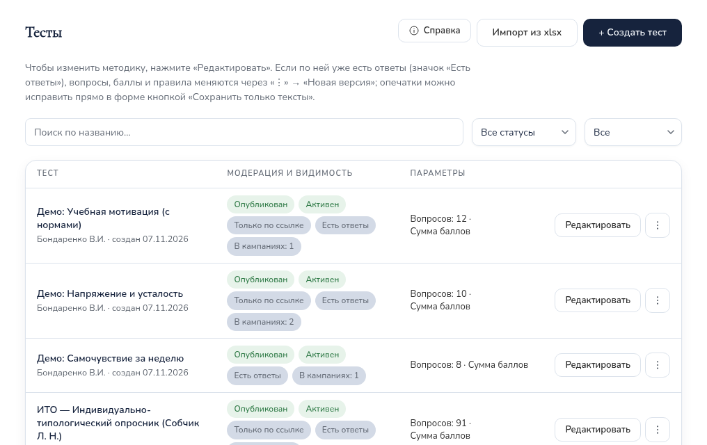
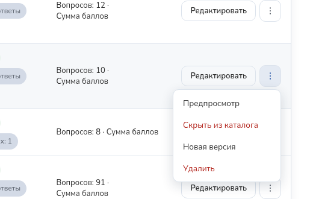
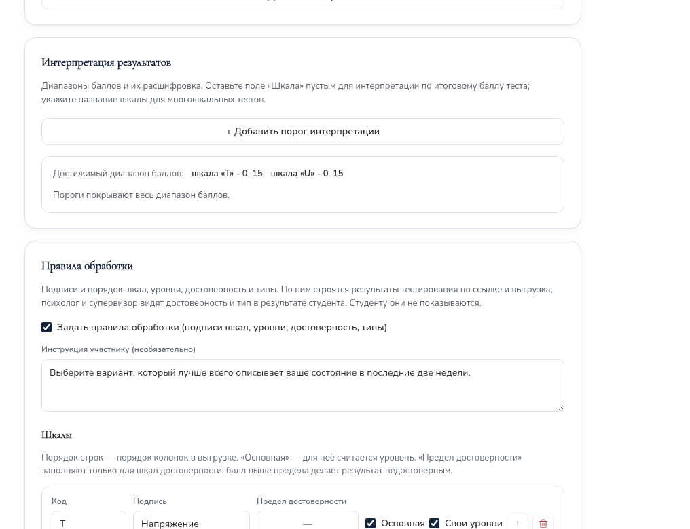
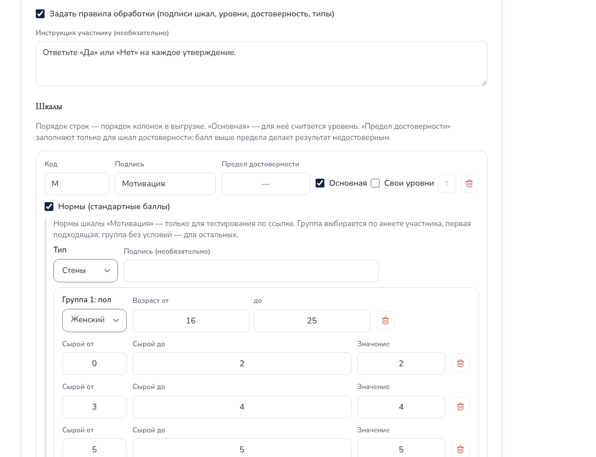
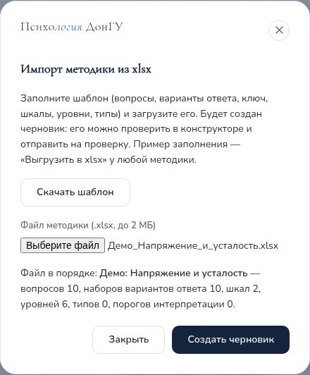
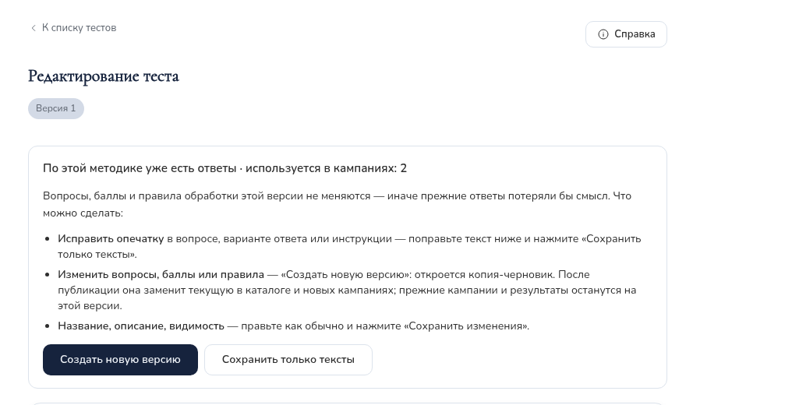

## 1. Что такое методика {#overview}

Методика — это тест: вопросы, варианты ответа, **ключ** (сколько баллов даёт каждый
ответ и по какой шкале) и **правила обработки** (подписи шкал, уровни,
достоверность, типы, нормы). Все методики собраны в разделе меню **«Тесты»**
(у психолога — «Мои тесты»). Одна и та же методика может использоваться:

- в **каталоге тестов**, который студент проходит в личном кабинете;
- в **тестировании по ссылке** — см. руководство «[Тестирование по ссылке](campaigns.html)».

| Роль | Что может |
|---|---|
| Супервизор, администратор | Видят все методики. Создают, загружают из файла, правят, публикуют, скрывают и удаляют. Проверяют методики психологов: публикуют или возвращают на доработку. |
| Психолог | Видит только свои методики. Создаёт, загружает, правит и отправляет на модерацию. Опубликовать сам не может. |
| Студент | Видит в каталоге только опубликованные и включённые методики и только вопросы — ключ и правила обработки ему не показываются. |

### Методика и тест: в чём разница {#terms}

Это не два разных объекта, а одна запись, на которую смотрят с двух сторон.

| | Тест | Методика |
|---|---|---|
| Кто так говорит | Студент, каталог тестов | Сотрудники: психолог, супервизор, администратор |
| Что имеется в виду | То, что проходит респондент: вопросы, варианты ответа, результат с пояснением | Тест вместе с тем, как он устроен и обрабатывается: ключ, шкалы, уровни, достоверность, типы, нормы |
| Что с ней делают | Проходят и смотрят результат | Создают, правят, загружают из xlsx, публикуют, ведут версии |

Одна и та же методика работает в двух местах: в каталоге (результат студента
сохраняется в его аккаунте) и в тестировании по ссылке (участник без аккаунта,
ответы хранятся отдельно). Методику, которая нужна только для кампаний, можно
скрыть из каталога — кампанию по ней создать всё равно можно.

Обычный порядок работы: создать методику в конструкторе или загрузить из файла
xlsx (разделы 3, 7) → задать правила обработки (4) → проверить предпросмотром (5) →
опубликовать (6) → использовать в каталоге или в кампании (10).

На странице «Тесты» и в форме методики есть кнопка **«Справка»** — она
открывает это руководство в новой вкладке, заполненная форма не теряется.

## 2. Список методик {#list}

Вверху — кнопки «Справка», «Импорт из xlsx» и «+ Создать тест», под ними —
короткая подсказка, поиск по названию и фильтры по статусу и видимости.

| Колонка | Что показывает |
|---|---|
| Тест | Название, автор, дата создания. |
| Модерация и видимость | Статус (таблица ниже); «Активен» или «Скрыт»; «Версия N», если версий несколько; «Заменена новой версией»; «Только по ссылке»; **«Есть ответы»** — методику уже проходили, её вопросы и правила меняются только новой версией (раздел 8); **«В кампаниях: N»** — в скольких кампаниях она выбрана. |
| Параметры | Число вопросов и способ подсчёта. |
| Действия | Основная кнопка («Редактировать» или «Опубликовать») и меню «⋮». |

<figure>

<figcaption>Меню «⋮»: «Предпросмотр», «Скрыть из каталога», «Новая версия» (у опубликованной методики с ответами), «Удалить».</figcaption>
</figure>

| Статус | Что значит |
|---|---|
| Черновик | Методика в работе. Студенты её не видят, для кампании её выбрать нельзя. |
| На проверке | Психолог отправил методику на модерацию. Ждёт решения супервизора; автор её в это время не правит. |
| Нужны правки | Супервизор вернул методику автору с комментарием. |
| Опубликован | Методика доступна в каталоге (если включена и не «Только по ссылке») и при создании кампаний. |

Число методик «на проверке» показывается бейджем у пункта «Тесты» в меню
супервизора.

## 3. Создание методики в конструкторе {#create}

Конструктор подходит для любой методики, в том числе с картинками, аудио, видео и
разными вариантами ответа у разных вопросов.

| № | Что сделать | Что вы увидите |
|---|---|---|
| 1 | В разделе «Тесты» нажать «+ Создать тест». | Форма «Новый тест»: «Основное», «Вопросы», «Интерпретация результатов», «Правила обработки». |
| 2 | Заполнить «Основное» (таблица ниже). | — |
| 3 | В «Вопросах» нажать «+ Добавить вопрос» и заполнить вопрос; повторить для всех. | Карточки «Вопрос 1», «Вопрос 2»… Порядок — стрелками, удаление — корзиной. |
| 4 | При необходимости заполнить «Интерпретацию результатов» и «Правила обработки» (раздел 4). | Под правилами — результат проверки (раздел 5). |
| 5 | Нажать «Предпросмотр» и пройти методику глазами студента. | Окно «Предпросмотр — так тест видит студент». |
| 6 | Нажать «Создать тест». | Методика появляется в списке. |

**Раздел «Основное»**

| Поле | Что задаёт |
|---|---|
| Название * | Обязательно. Его видят студенты и участники тестирования по ссылке. |
| Описание | Кратко о методике. Если инструкция в правилах не задана, перед вопросами показывается описание. |
| Метод подсчёта | «Сумма баллов», «Среднее значение» или «Взвешенная сумма (вес вопроса)». |
| Лимит времени, мин | Необязательно. Только для каталога. |
| Типы материалов, Темы | Необязательно — для группировки. |
| Статус | Только при создании супервизором: «Черновик» или «Опубликован сразу». Психолог всегда создаёт черновик. |
| Активен — виден студентам в каталоге | Снятая отметка скрывает методику из каталога. |
| Перемешивать порядок вопросов / вариантов | Только для каталога. |
| Только для тестирования по ссылке | Методика не показывается в каталоге, но доступна для кампаний. |

**Тип ответа вопроса**

| Тип | Как считается |
|---|---|
| Один вариант | Выбирается один вариант, у каждого — свой балл (например, «Да» — 1, «Нет» — 0). Варианты у каждого вопроса свои. |
| Несколько вариантов | Баллы выбранных вариантов складываются. |
| Шкала | Число от «Минимума» до «Максимума» с «Шагом»; балл равен числу. |
| Свободный ответ | Текст; в подсчёте не участвует, хранится зашифрованным. |

- **Шкала (для многошкальных)** — код шкалы вопроса («L», «VII», «T»). Шкала
  указывается либо у всех вопросов, которые дают баллы, либо ни у одного.
  Вопрос, у которого все варианты дают 0 баллов (вводный), можно оставить без
  шкалы.
- **Обратный ключ** — просто другие баллы у вариантов: у прямого вопроса
  «всегда — 3 … никогда — 0», у обратного «всегда — 0 … никогда — 3».
- **Медиа:** к вопросу — изображения, аудио, видео; к варианту — картинка.
- **Интерпретация результатов** — пороги баллов с «Названием уровня» и
  «Рекомендацией»: этот текст студент видит в своём результате в каталоге.

## 4. Правила обработки {#rules}

Правила описывают первичную обработку: подписи и порядок шкал в таблице xlsx,
уровни, достоверность, типы и нормы. Поставьте отметку **«Задать правила
обработки»**. Для ИТО правила заполнены по методичке — их удобно открыть как образец.

| Что задаётся | Как заполнить |
|---|---|
| Инструкция участнику | Текст перед вопросами. |
| Шкалы | «+ Шкала» или «Добавить шкалы из вопросов». Для каждой: «Код» (как у вопросов), «Подпись», отметка «Основная» — для неё считается уровень. Порядок строк (стрелка «↑») — порядок колонок в таблице xlsx. |
| Предел достоверности | Только у шкал достоверности (у ИТО — L и F, предел 5). Балл выше предела — результат «недостоверно». |
| Пометка недостоверного результата | Текст у недостоверных результатов (у ИТО — «недостоверно»). |
| Уровни основных шкал | Общие для основных шкал диапазоны: «Код (латиница)», «Название», «От», «До», по возрастанию, без пропусков. У ИТО: 0–2, 3–4, 5–7, 8–9. |
| Свои уровни | У шкалы, пороги которой отличаются от общих (раздел 4.1). |
| Нормы | Перевод сырого балла в стены, T-баллы и т. п. (раздел 4.2). |
| Типы | «Порог типа» и «+ Тип»: название и шкалы. Тип выражен, если все его шкалы набрали не меньше порога. |

- Уровни, достоверность, типы и нормы видят только психолог и супервизор.
  Студенту они не показываются.
- Без правил методика тоже работает: студент получает баллы и интерпретацию, в
  результатах кампании выводятся баллы и средние.

### 4.1. Свои уровни шкалы {#own-levels}

Если у шкал разные пороги (например, «Напряжение» 0–5 / 6–9 / 10–15, а
«Усталость» 0–4 / 5–9 / 10–15), у основной шкалы поставьте отметку **«Свои
уровни»** и задайте её уровни — они заменят общие для этой шкалы. Шкалы без
этой отметки используют общие «Уровни основных шкал».

### 4.2. Нормы (стандартные баллы) {#norms}

Нормы переводят сырой балл шкалы в стандартный — стены, T-баллы, станайны,
процентили — по таблице из методички. Нормы применяются **только в тестировании
по ссылке**: там есть анкета (пол, возраст, факультет). В каталоге студента их
нет.

1. У шкалы поставьте отметку **«Нормы (стандартные баллы)»**.
2. Выберите «Тип» (Стены, T-баллы, Станайны, Процентили, Другое) и при
   необходимости «Подпись».
3. Заполните **группы**: «Пол» (любой, женский, мужской), «Возраст от … до» и
   строки таблицы «Сырой от», «Сырой до», «Значение». Строки — без пересечений,
   покрывают все возможные баллы шкалы.
4. Группа выбирается по анкете участника — **первая подходящая** по порядку.
   Последней поставьте группу без условий — для всех остальных. Если подходящей
   группы нет, стандартный балл не считается.

В результатах кампании стандартный балл стоит в скобках после сырого, в xlsx —
отдельной колонкой «<шкала> (Стены)». В методичке ИТО (Собчик Л. Н.) таблиц
перевода нет — ИТО считается по сырым баллам.

## 5. Проверка перед публикацией {#check}

**Замечания под правилами.** Сайт сам сверяет правила с вопросами: «Правила
согласованы с вопросами» или список расхождений — шкала есть у вопросов, но не
описана в правилах; шкала из правил не встречается в вопросах; уровни или
таблица норм покрывают не все возможные баллы шкалы. **Пока расхождения есть,
методику нельзя отправить на модерацию или опубликовать.**

**Замечания к интерпретации** (непокрытые или недостижимые диапазоны) публикацию
не блокируют.

**Предпросмотр** (в форме и в меню «⋮») показывает методику так, как её видит
студент. Ответьте и нажмите **«Посчитать результат»**: появятся баллы по шкалам с
уровнями, достоверность и тип. Ничего не сохраняется. Проверьте ключ на крайних
случаях: все ответы «Да», все «Нет», ответы для недостоверного результата.

## 6. Публикация и модерация {#publish}

**Методика супервизора** публикуется сразу при создании («Опубликован сразу») или
позже кнопкой **«Опубликовать»** в списке.

**Методика психолога** проходит модерацию:

| № | Что сделать | Что вы увидите |
|---|---|---|
| 1 | Психолог проверяет методику и нажимает «Отправить на модерацию». | Статус «На проверке», у супервизора — бейдж в меню. |
| 2 | Супервизор открывает «Тесты», фильтр «На проверке», проверяет («Предпросмотр», «Редактировать»). | — |
| 3 | Всё верно — «Опубликовать». | «Опубликован»; психолог получает сообщение. |
| 4 | Нужны исправления — «Вернуть на доработку» с комментарием. | «Нужны правки»; психолог исправляет и отправляет снова. |

Если психолог правит свою опубликованную методику, она снимается с публикации и
снова проходит модерацию. Правка супервизором статус не меняет.

## 7. Загрузка методики из файла xlsx {#import}

Удобно, когда методика уже есть в таблице: вопросы и ключ переносятся
копированием.

| № | Что сделать | Что вы увидите |
|---|---|---|
| 1 | «Импорт из xlsx» → «Скачать шаблон». | Файл «Шаблон_методики.xlsx»; первый лист — «Как заполнить». |
| 2 | Заполнить листы (таблица ниже), сохранить как xlsx. | — |
| 3 | В окне импорта выбрать файл. | Сводка или список ошибок. |
| 4 | Ошибки — исправить по адресу (лист, строка, колонка) и выбрать файл снова. | «Файл в порядке: …» |
| 5 | «Создать черновик». | Форма методики со статусом «Черновик». |
| 6 | Проверить (раздел 5) и опубликовать или отправить на модерацию. | — |

**Листы шаблона** (первая строка — заголовки, их не менять):

| Лист | Что заполнить |
|---|---|
| Методика | «Поле» / «Значение»: Название (обязательно), Описание, Инструкция, Подсчёт (сумма, среднее, взвешенная), Только по ссылке (да / нет), Пометка недостоверности. |
| Варианты ответа | Общий набор для всех вопросов: «Порядок», «Текст варианта» — 1 Да, 2 Нет или 1…5 для шкалы Лайкерта. |
| Варианты вопросов | Если у вопроса **свои** варианты (как в опросниках с разными ответами на каждый вопрос): «№ вопроса», «Порядок» (1, 2, … у каждого вопроса заново), «Текст варианта». Свой набор заменяет общий; если свои варианты у всех вопросов, лист «Варианты ответа» можно не заполнять. |
| Вопросы | «№», «Текст вопроса». Номера подряд с 1. |
| Ключ | «Шкала», «№ вопроса», «Вариант (порядок)» — в наборе этого вопроса, «Балл». Строка на каждый значимый ответ; ответ без строки даёт 0. Пример ИТО: «VII · 8 · 1 · 1» — ответ «Да» на вопрос 8 даёт 1 балл по шкале VII. |
| Шкалы | «Код», «Подпись», «Основная (да/нет)», «Предел достоверности»; для норм — «Нормы: тип» (sten, t, stanine, percentile, custom) и «Нормы: подпись». |
| Уровни | «Код (латиница)», «Название», «От», «До», «Шкала» — пусто: общий уровень; код основной шкалы: свой уровень этой шкалы. |
| Типы | «Название типа», «Шкалы (через запятую)», «Порог» (одинаковый у всех). |
| Интерпретация | Необязательно: шкала, «От», «До», «Название», «Рекомендация». |
| Нормы | Необязательно: «Шкала», «Пол» (муж/жен, пусто — любой), «Возраст от», «Возраст до», «Факультет» (код, пусто — любой), «Сырой балл от», «Сырой балл до», «Значение». Строки с одинаковыми шкалой, полом, возрастом и факультетом — одна группа, в порядке появления. |

- **Готовые образцы:** «Выгрузить в xlsx» в форме любой методики (например, ИТО
  или демо-методик, раздел 9). Возьмите файл за основу и смените название на
  листе «Методика».
- Импорт всегда создаёт **новую методику-черновик**, существующие не меняет.
- Ограничения шаблона: вопросы — с выбором одного ответа; без картинок, аудио и
  видео; вопрос — не больше чем в одной шкале; файл до 2 МБ, только xlsx.

| Сообщение | Что исправить |
|---|---|
| «Это не файл xlsx» | Сохраните файл как «Книга Excel (.xlsx)». |
| «номера должны идти подряд» | На листе «Вопросы» или «Варианты вопросов» пропущен или повторён номер. |
| «нет такого варианта у этого вопроса» | В «Ключе» номер варианта больше числа вариантов этого вопроса. |
| «нет вариантов ответа у вопросов …» | Заполните «Варианты ответа» или строки этих вопросов на «Вариантах вопросов». |
| «нет такой шкалы на листе «Шкалы»» | В «Уровнях» или «Нормах» указан код шкалы, которой нет на листе «Шкалы». |
| «свои уровни — только у основной шкалы» | Отметьте шкалу как основную или уберите код шкалы в «Уровнях». |
| «тип норм указан, но на листе «Нормы» нет строк» | Заполните «Нормы» или очистите колонку «Нормы: тип». |
| Замечание «уровни не покрывают баллы …» | Не ошибка — черновик создаётся, но до публикации закройте пропуск. |

## 8. Изменение методики {#edit}

Нажмите **«Редактировать»** в строке методики (в карточке кампании — «Открыть
методику»). Если по методике **уже есть ответы** (значок «Есть ответы»), форма
сразу показывает, что можно сделать:

| Ситуация | Что сделать |
|---|---|
| Ответов ещё нет | Правьте как обычно → «Сохранить изменения». Если методика выбрана в кампаниях без ответов, форма предупредит: правки сразу применятся и к ним. |
| Ответы есть, нужна опечатка | Исправьте текст вопроса, варианта или инструкции → **«Сохранить только тексты»**. Баллы и состав не меняются. |
| Ответы есть, нужно изменить вопросы, баллы или правила | **«Создать новую версию»** (в форме) или «⋮» → «Новая версия» (в списке). Откроется черновик «Версия 2» — исправьте и опубликуйте. Прежняя версия получит пометку «Заменена новой версией»: её не будет в каталоге и при создании новых кампаний, а прежние результаты и идущие кампании останутся на ней. |
| Ответы есть, нужно поменять название, описание, видимость | Правьте → «Сохранить изменения». |
| Нужна похожая, но отдельная методика | «Дублировать» — независимая копия-черновик. |
| Методику нужно временно убрать | «⋮» → «Скрыть из каталога»; вернуть — «Показать в каталоге». Скрытую нельзя выбрать для новой кампании. |
| Методика больше не нужна | «Удалить». Методику, по которой есть кампания, удалить нельзя — скройте её. |
| Нужна копия в файле | «Выгрузить в xlsx» в форме методики. |

Почему так: ответы прошедших привязаны к вопросам и баллам методики — если их
поменять, прежние результаты потеряют смысл.

## 9. Демо-методики {#demo}

На демо-стенде есть методики-образцы с собственными текстами — на них удобно
пробовать возможности:

| Методика | Что показывает |
|---|---|
| Демо: Самочувствие за неделю | Шкала Лайкерта (5 вариантов), обратные пункты, одна шкала, уровни и интерпретация; видна и в каталоге студента. |
| Демо: Напряжение и усталость | Свои варианты ответа у каждого вопроса, обратный ключ, две шкалы со своими уровнями. |
| Демо: Учебная мотивация (с нормами) | «Да / Нет», шкала искренности (достоверность), тип, нормы-стены по полу и возрасту. |

По ним уже есть демо-кампании с ответами, поэтому правка вопросов идёт через
новую версию. Чтобы попробовать свободную правку, сделайте копию: «Дублировать»
или выгрузите в xlsx и загрузите обратно.

## 10. Где используются методики {#where}

| Где | Что видно |
|---|---|
| Каталог тестов студента | Опубликованные, включённые, не «Только по ссылке» и не заменённые новой версией методики. Студент видит свой балл и интерпретацию. |
| Результат студента из каталога | Психолог — в карточке клиента, супервизор — в карточке студента: баллы, уровни, достоверность, тип. Просмотр записывается в журнал. |
| Тестирование по ссылке | При создании кампании — все опубликованные и включённые методики, кроме заменённых. Результаты, статистика и xlsx — см. «[Тестирование по ссылке](campaigns.html#results)». |

Ответы из каталога и из тестирования по ссылке хранятся раздельно и не
смешиваются.

## 11. Частые вопросы {#faq}

| Ситуация | Что делать |
|---|---|
| Не получается изменить вопросы — форма пишет, что есть ответы. | Опечатку — «Сохранить только тексты»; остальное — «Создать новую версию» (раздел 8). |
| Нужной методики нет при создании кампании. | Она не опубликована, скрыта или заменена новой версией — проверьте в «Тестах». |
| Методика не отправляется на модерацию или не публикуется. | Под «Правилами обработки» есть расхождения — исправьте (раздел 5). |
| Как убрать методику из каталога, но оставить для тестирования по ссылке? | Отметка «Только для тестирования по ссылке» в «Основном». |
| Психолог не может изменить свою методику. | Она «На проверке» — дождитесь решения или попросите вернуть на доработку. |
| Импорт пишет об ошибках. | Исправьте ячейки по листу, строке и колонке (таблица в разделе 7) и выберите файл снова. |
| Не считается стандартный балл (стен). | Для участника не нашлась группа норм или балл вне таблицы — добавьте группу без условий и проверьте покрытие баллов. |
