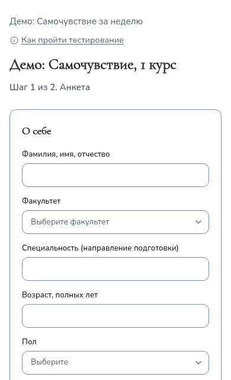

1. **Откройте ссылку**, которую вам прислали, — с телефона или компьютера.
   Регистрация на сайте не нужна.
2. Если на странице есть поле **«Кодовое слово»** — введите слово, которое
   сообщили организаторы, и нажмите «Продолжить». Большие и маленькие буквы не
   важны.
3. **Заполните анкету:** ФИО, факультет, специальность, возраст, пол.
4. Прочитайте **согласие на обработку персональных данных** и поставьте
   отметку — без неё перейти к вопросам нельзя.
5. Нажмите **«Перейти к вопросам»**, прочитайте инструкцию и ответьте на все
   вопросы. Отвечайте искренне и не раздумывайте долго — правильных и
   неправильных ответов нет. Сверху видно, сколько вопросов уже отвечено.
6. Нажмите **«Отправить ответы»**. Появится «Спасибо за участие!» —
   тестирование завершено.

<figure class="phone">

<figcaption>Так выглядит начало теста на телефоне.</figcaption>
</figure>

**Полезно знать**

- Обычно тестирование занимает 10–20 минут. Проходите его один раз и до конца.
- Если случайно обновили страницу — ответы сохранятся, пока открыта вкладка. Если
  закрыть вкладку, придётся начать сначала.
- Если вверху написано «Пройти можно до …» — успейте до этого времени.
- Результаты обрабатывают специалисты центра психологии ДонГУ. Они
  конфиденциальны и на экран не выводятся.

**Если что-то пошло не так**

| На экране | Что делать |
|---|---|
| «Тестирование ещё не началось» | Откройте ссылку в указанное время. |
| «Неверное кодовое слово» | Уточните слово у организаторов. |
| «Опрос недоступен» | Тестирование завершено или ссылка скопирована не полностью — обратитесь к тому, кто её прислал. |

Вопросы о тестировании можно задать центру психологической помощи ДонГУ:
psychology.center@donnu.ru.
